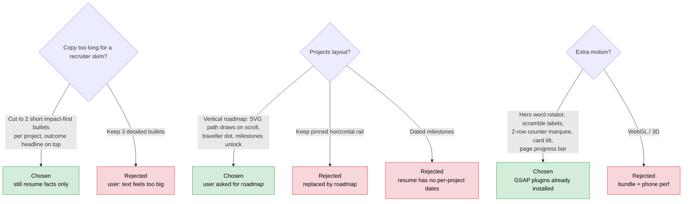
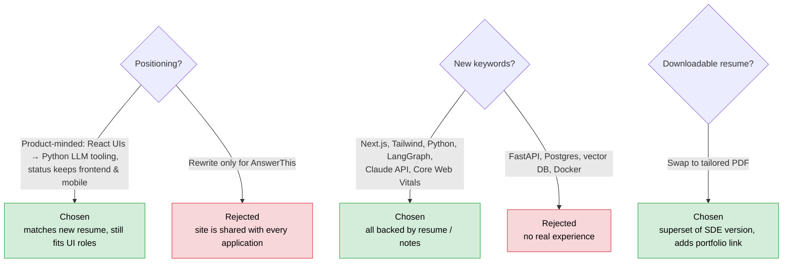
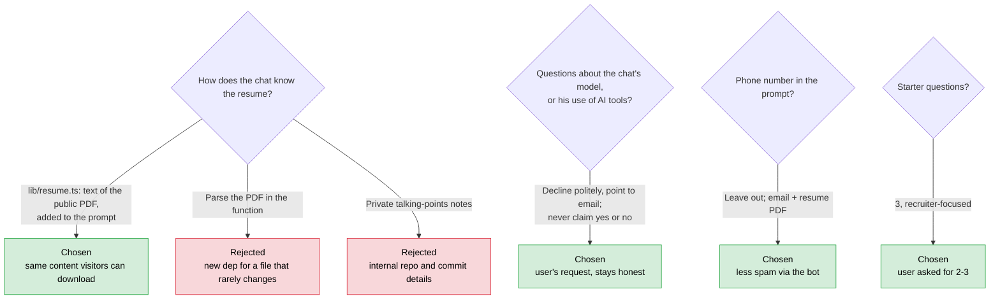
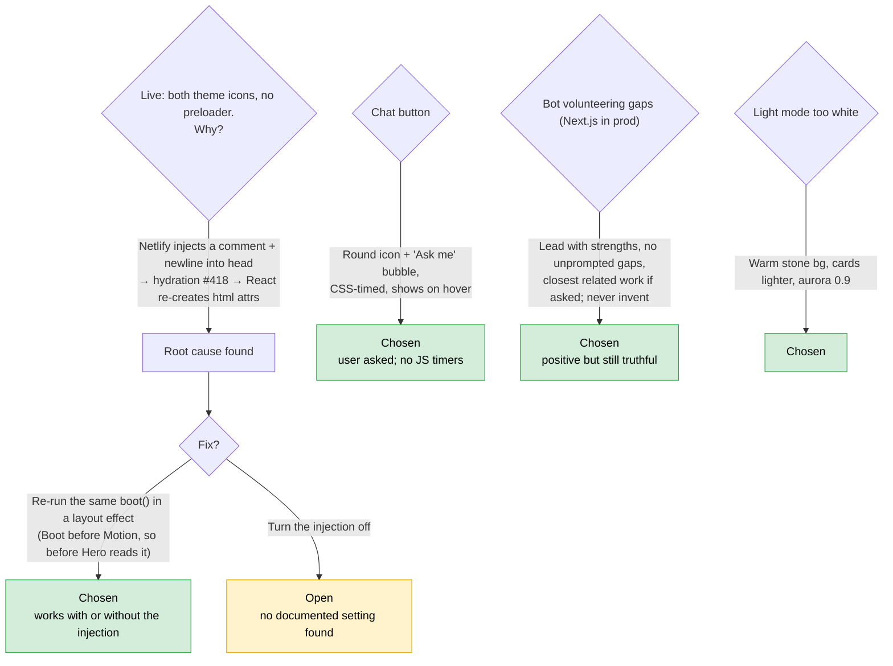
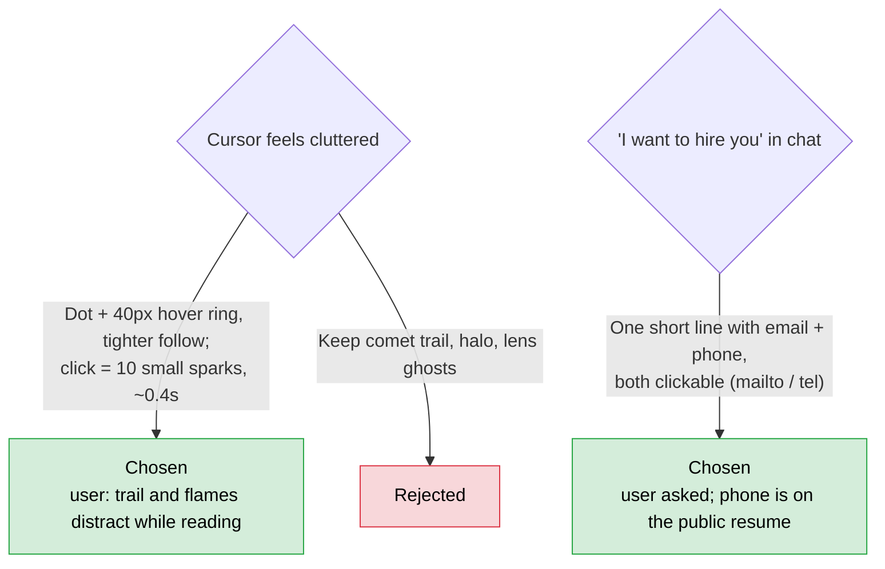
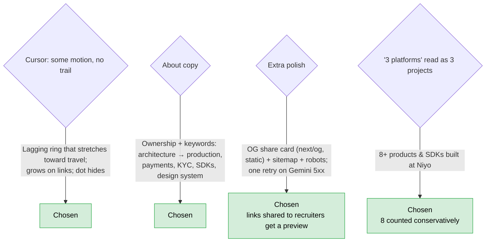

# Decisions

## 2026-10-27 — Portfolio site (personal, no Jira)

```mermaid
flowchart TD
  Q1{"Framework?"} -->|"Next.js 16 + GSAP + Lenis"| A1["Chosen<br/>user pick; React signal for recruiters"]
  Q1 -->|"+ React Three Fiber"| R1["Rejected<br/>heavy bundle, slow on phones"]
  Q1 -->|"Astro"| R2["Rejected<br/>weaker React signal"]

  Q2{"Styling?"} -->|"One globals.css + CSS vars"| A2["Chosen<br/>zero config, one-page site"]
  Q2 -->|"Tailwind"| R3["Rejected<br/>config + utility noise for 1 page"]

  Q3{"Text splitting?"} -->|"Split in JSX"| A3["Chosen<br/>React owns the DOM, no plugin"]
  Q3 -->|"GSAP SplitText"| R4["Rejected<br/>mutates React-owned DOM"]

  Q4{"Vibe? (user deferred)"} -->|"Dark cinematic + editorial type"| A4["Chosen<br/>fits fintech + security precision"]
  Q4 -->|"Terminal / playful"| R5["Rejected<br/>gimmicky for SDE hiring"]

  Q5{"Work section?"} -->|"Pinned horizontal (desktop)<br/>stacked grid (mobile / reduced motion)"| A5["Chosen"]

  Q6{"Content source?"} -->|"Resume PDF only"| A6["Chosen<br/>no invented claims"]
  Q6 -->|"Phone number on page"| R6["Rejected<br/>public site, email is enough"]
  Q7{"Resume PDF downloadable?<br/>(it contains phone no.)"} --> O1["Open<br/>linked for now — user decides"]
  Q8{"Deploy target"} --> O2["Open<br/>Vercel suggested, user deploys"]

  classDef chosen fill:#d4edda,stroke:#28a745,color:#000
  classDef rejected fill:#f8d7da,stroke:#dc3545,color:#000
  classDef open fill:#fff3cd,stroke:#e0a800,color:#000
  class A1,A2,A3,A4,A5,A6 chosen
  class R1,R2,R3,R4,R5,R6 rejected
  class O1,O2 open
```

- Every animation gated behind `prefers-reduced-motion: no-preference`; reduced-motion users get a static, fully readable page.
- Custom cursor + magnetic buttons only on fine pointers; native cursor stays if JS fails.
- No OG image / case-study pages yet — add when there are screenshots or write-ups to show.

## 2026-10-27 — Punchier copy, roadmap projects, more motion

- Path is generated from measured milestone positions, so it follows the layout on desktop (centre spine) and mobile (left rail).

## 2026-10-28 — Align portfolio with the product-engineer resume

## 2026-11-13 — AI "Ask about me", case studies, light/dark mode

```mermaid
flowchart TD
  Q1{"Which LLM for the chat?"} -->|"Gemini free tier<br/>(user's pick)"| A1["Chosen<br/>no cost; prompts may train Google models"]
  Q1 -->|"Claude Haiku, paid key"| R1["Rejected<br/>user chose free tier"]
  Q1 -->|"Preset Q&A only"| R2["Rejected<br/>visitors can't ask their own question"]

  Q2{"Where does the API key live?"} -->|"Netlify Function at /api/ask,<br/>site stays a static export"| A2["Chosen<br/>key never reaches the browser"]
  Q2 -->|"Drop output: export for Next API routes"| R3["Rejected<br/>bigger change, needs Netlify Next runtime"]

  Q3{"Abuse control?"} -->|"Netlify code-based rate limit<br/>10 req/min per IP + input caps"| A3["Chosen<br/>works on free plan, no new deps"]
  Q3 -->|"Captcha / auth"| R4["Rejected<br/>friction for recruiters"]

  Q4{"What does the AI know?"} -->|"Prompt built from lib/content.ts<br/>(site copy + case studies)"| A4["Chosen<br/>one source of truth, stays in sync"]
  Q4 -->|"RAG / vector store"| R5["Rejected<br/>~3k tokens fits in the prompt"]

  Q5{"'More professional'?"} -->|"Case-study page per project,<br/>SSG via generateStaticParams"| A5["Chosen<br/>user's pick: keep look, add depth"]
  Q5 -->|"Calmer redesign"| R6["Rejected<br/>user kept the bold look"]

  Q6{"Theme switching?"} -->|"data-theme on html, set by an inline<br/>head script from localStorage or OS"| A6["Chosen<br/>no flash of wrong theme"]
  Q6 -->|"next-themes"| R7["Rejected<br/>new dep for ~5 lines"]

  Q7{"Preloader on new pages?"} -->|"Only on first home visit per session"| A7["Chosen<br/>back-navigation stays fast"]

  classDef chosen fill:#d4edda,stroke:#28a745,color:#000
  classDef rejected fill:#f8d7da,stroke:#dc3545,color:#000
  class A1,A2,A3,A4,A5,A6,A7 chosen
  class R1,R2,R3,R4,R5,R6,R7 rejected
```

- Case-study copy follows the resume talking points: "built" vs "launched" kept, partner names generic, RedCell numbers marked as simulator results.
- Light mode splits the accent into a fill (`--accent`) and a darker text ink (`--accent-ink`), because lime text is unreadable on white.
- Model name comes from `GEMINI_MODEL` (default `gemini-3.5-flash-lite`) because Gemini models are retired often.

## 2026-11-13 — Chat answers from the full resume; no talk about its own model

## 2026-11-13 — Live-site fixes: theme lost after Netlify injection, chat button, positive answers

## 2026-11-13 — Calmer cursor; hiring questions get email + phone

## 2026-11-13 — Cursor ring, ownership copy, share card, stats

