# Decisions

## 2026-10-27 — Portfolio site (personal, no Jira)

```mermaid
flowchart TD
  Q1{"Framework?"} -->|"Next.js 16 + GSAP + Lenis"| A1["Chosen<br/>user pick; React signal for recruiters"]
  Q1 -->|"+ React Three Fiber"| R1["Rejected<br/>heavy bundle, slow on phones"]
  Q1 -->|"Astro"| R2["Rejected<br/>weaker React signal"]

  Q2{"Styling?"} -->|"One globals.css + CSS vars"| A2["Chosen<br/>zero config, one-page site"]
  Q2 -->|"Tailwind"| R3["Rejected<br/>config + utility noise for 1 page"]

  Q3{"Text splitting?"} -->|"Split in JSX"| A3["Chosen<br/>React owns the DOM, no plugin"]
  Q3 -->|"GSAP SplitText"| R4["Rejected<br/>mutates React-owned DOM"]

  Q4{"Vibe? (user deferred)"} -->|"Dark cinematic + editorial type"| A4["Chosen<br/>fits fintech + security precision"]
  Q4 -->|"Terminal / playful"| R5["Rejected<br/>gimmicky for SDE hiring"]

  Q5{"Work section?"} -->|"Pinned horizontal (desktop)<br/>stacked grid (mobile / reduced motion)"| A5["Chosen"]

  Q6{"Content source?"} -->|"Resume PDF only"| A6["Chosen<br/>no invented claims"]
  Q6 -->|"Phone number on page"| R6["Rejected<br/>public site, email is enough"]
  Q7{"Resume PDF downloadable?<br/>(it contains phone no.)"} --> O1["Open<br/>linked for now — user decides"]
  Q8{"Deploy target"} --> O2["Open<br/>Vercel suggested, user deploys"]

  classDef chosen fill:#d4edda,stroke:#28a745,color:#000
  classDef rejected fill:#f8d7da,stroke:#dc3545,color:#000
  classDef open fill:#fff3cd,stroke:#e0a800,color:#000
  class A1,A2,A3,A4,A5,A6 chosen
  class R1,R2,R3,R4,R5,R6 rejected
  class O1,O2 open
```

- Every animation gated behind `prefers-reduced-motion: no-preference`; reduced-motion users get a static, fully readable page.
- Custom cursor + magnetic buttons only on fine pointers; native cursor stays if JS fails.
- No OG image / case-study pages yet — add when there are screenshots or write-ups to show.
