# Flow

## 2026-10-27 — Portfolio site (personal, no Jira)

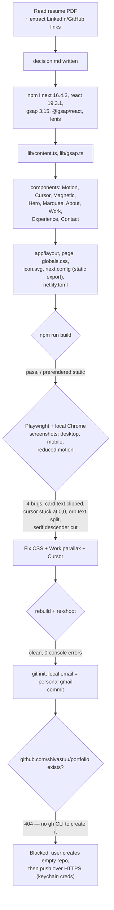

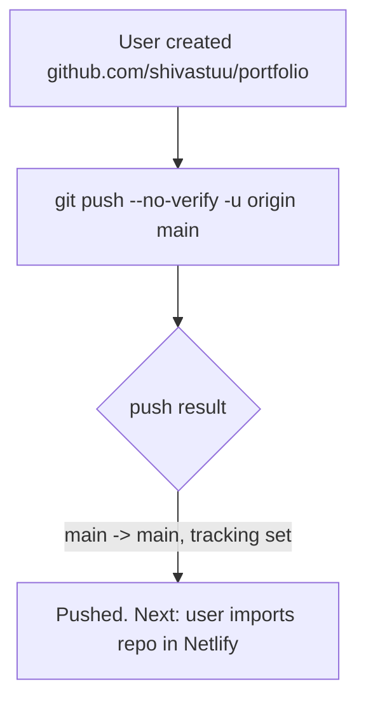

## 2026-10-27 — Punchier copy, roadmap projects, flare cursor, lighter theme

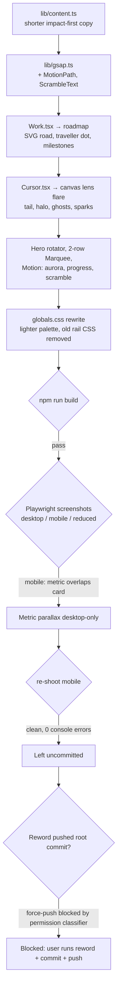

## 2026-10-28 — Align portfolio with the product-engineer resume

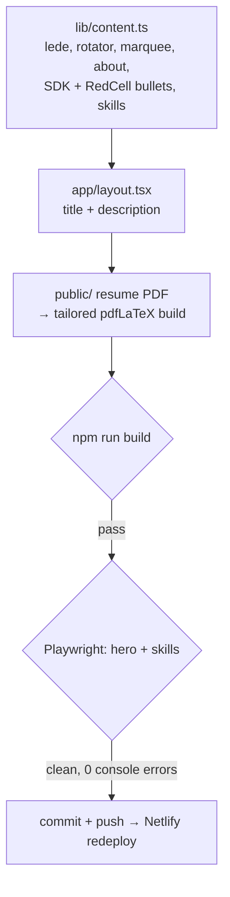

## 2026-11-13 — AI "Ask about me", case studies, light/dark mode

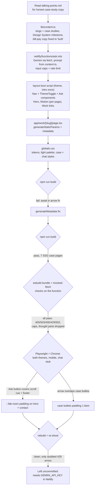

## 2026-11-13 — Chat answers from the full resume

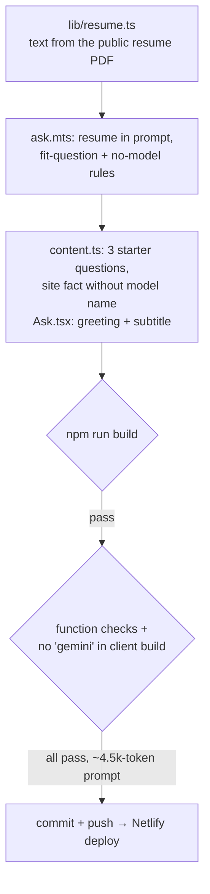

## 2026-11-13 — Live-site fixes

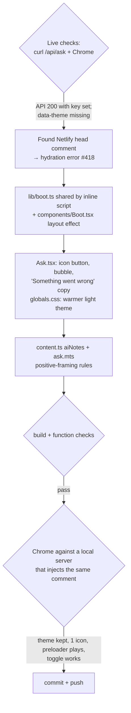

## 2026-11-13 — Calmer cursor; contact in chat

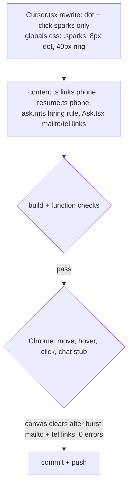

## 2026-11-13 — Cursor ring, ownership copy, share card, stats

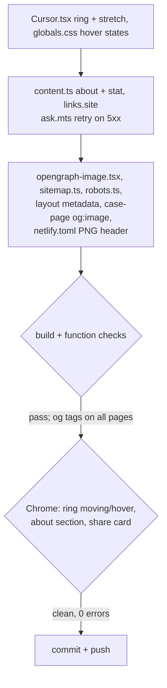

## 2026-11-13 — Stronger resume + site

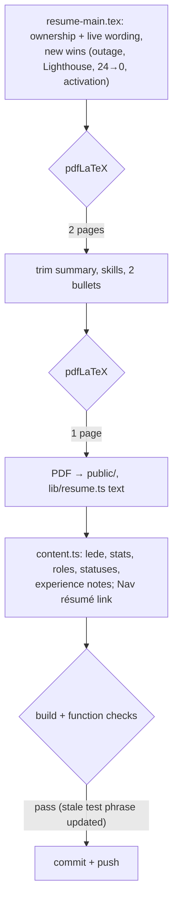

## 2026-11-13 — Prepare a move to Cloudflare Pages

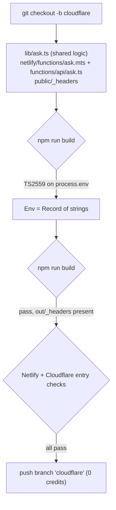
